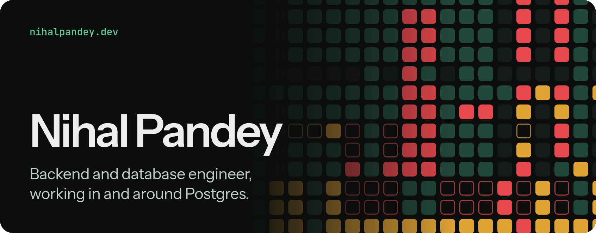
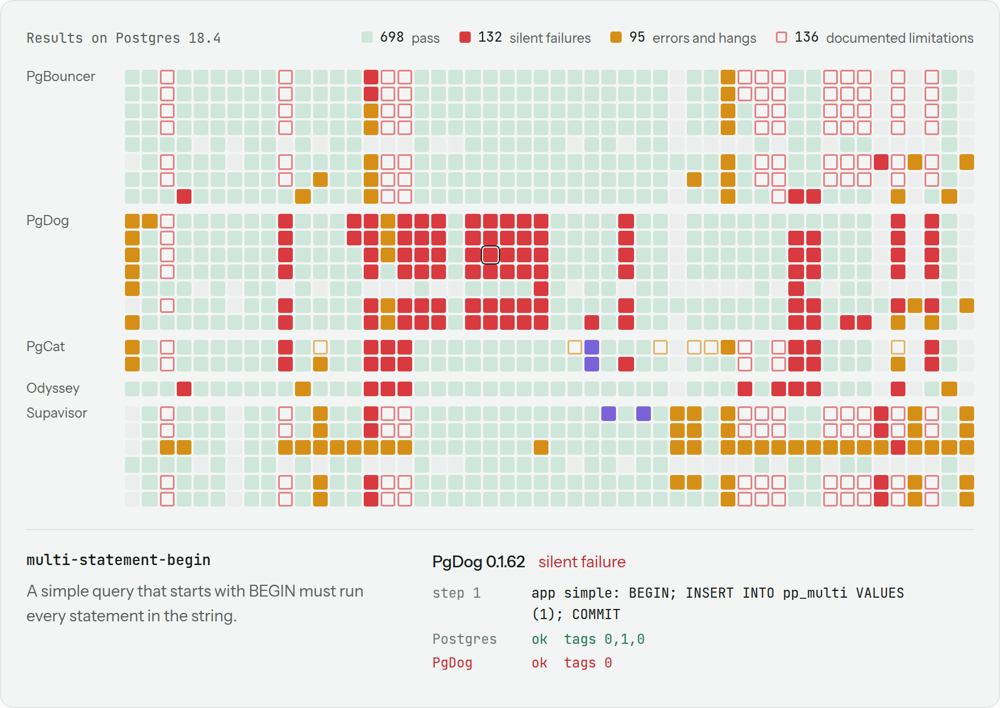
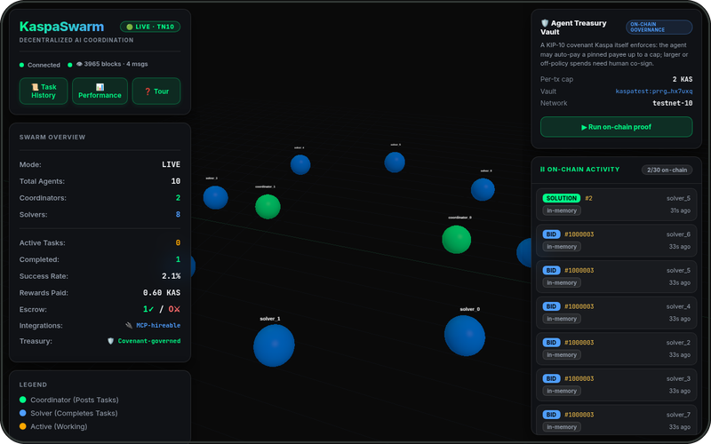
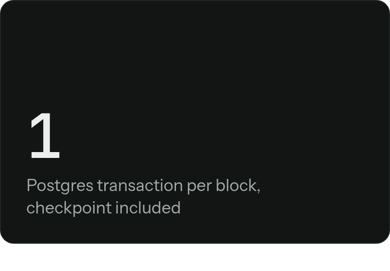
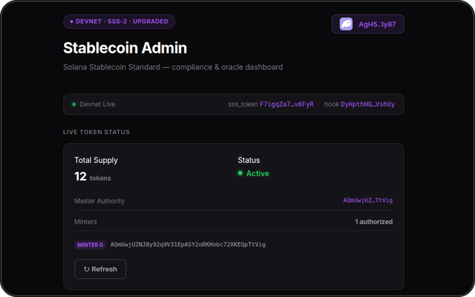
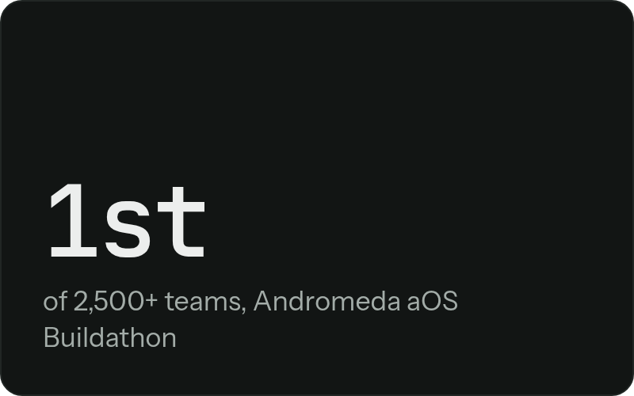

<b>Rust · Go · TypeScript · PostgreSQL · Redis</b>

  Most of my open-source work is on PostgreSQL: executor fixes in ParadeDB, and poolproof, which tests the connection poolers in front of it. At Tvaram I built the backends for Tasvam and MailTitan, both launching soon. Before that I wrote Rust security tooling at the Prime Minister's Office and built on Solana, EVM, Stellar and Kaspa, winning five hackathons along the way.

  &nbsp;
  &nbsp;
  &nbsp;
  

## Open Source

### [poolproof](https://github.com/Nihal-Pandey-2302/poolproof) · Rust

**Find out what breaks when you put a connection pooler in front of Postgres.**

Poolers like PgBouncer, PgDog and Supavisor are meant to be invisible. In transaction mode they mostly are, until a `SET` leaks to another client, a temp table appears in someone else's session, or half a query string silently never runs. poolproof replays small scenarios against plain Postgres and then through the pooler, and reports every step where the two differ. Postgres is the oracle, so no scenario hardcodes expected output.

<a href="https://nihal-pandey-2302.github.io/poolproof/">
  <picture>
    <source media="(prefers-color-scheme: dark)" srcset="assets/poolproof-results-dark.png">
    
  </picture>
</a>

  poolproof 0.1.1, snapshot of 4 Nov 2026. Columns are the 50 scenarios, rows the 24 pooler versions and configurations. 
  <a href="https://nihal-pandey-2302.github.io/poolproof/">Full results with every trace</a> &nbsp;·&nbsp;
  <a href="https://nihalpandey.dev/work/poolproof">How it was built</a>

- **50 scenarios** through **PgBouncer, PgDog, Supavisor, PgCat and Odyssey**, several versions of each, on Postgres 17 and 18.
- Built from **14 upstream issues**, each with the versions where it reproduces or stays fixed. PgDog answers only the `BEGIN` of `BEGIN; INSERT; COMMIT` and never commits the insert if the client disconnects ([pgdog#1849](https://github.com/pgdogdev/pgdog/issues/1849)). Supavisor hangs on 4 pipelined requests in 9 of 10 runs ([supavisor#1239](https://github.com/supabase/supavisor/issues/1239)).
- `poolproof scan` reads `pg_stat_statements` exports, Postgres logs or `.sql` files and flags the queries that break under transaction pooling, checked against what your pooler version actually did.
- Runs real drivers (psycopg, pgx, node-postgres, pgjdbc). Failures are classed as silent, error or hang, and documented limitations are kept apart from bugs.
- Ships as signed binaries for Linux, macOS and Windows, and as a GitHub Action for CI.

### [ParadeDB](https://github.com/paradedb/paradedb) (YC S23) · Rust · PostgreSQL · Tantivy

**3 pull requests merged.**

| PR | &nbsp;&nbsp;&nbsp;&nbsp;&nbsp;&nbsp;&nbsp;Status&nbsp;&nbsp;&nbsp;&nbsp;&nbsp;&nbsp;&nbsp; | What it does |
|---|:---:|---|
| [#4763](https://github.com/paradedb/paradedb/pull/4763) |  | `JoinScan` returned wrong rows when a self-join sorted on a column name both sides share. Late materialization was deduplicating columns by name, so I rewrote physical projection to bind them by index. A second case run during review showed my fix misbinding, and I rebuilt it. [Case study](https://nihalpandey.dev/work/joinscan-wrong-rows) |
| [#4924](https://github.com/paradedb/paradedb/pull/4924) |  | A nested `ExecutorRun` panicked in `fake_aminsertcleanup` on PG16. Review found a second bug in my first fix, on the recursive DML path, so I replaced its depth counter with an RAII `FrameGuard` that gives every nesting level its own frame. [Case study](https://nihalpandey.dev/work/nested-executor-run) |
| [#4765](https://github.com/paradedb/paradedb/pull/4765) |  | Removed `ctid` from `SearchIndexScore` in favour of batched lookups, folding 5 duplicated ctid-lookup blocks into one helper used by 6 execution paths. |
| [#5093](https://github.com/paradedb/paradedb/issues/5093) |  | Replace the `resolve_physical_index` heuristic with explicit column lineage tracking: the structural follow-up to #4763. |

## Experience

**Senior Founding Engineer & Tech Lead · [Tvaram](https://tvaram.com/)** 
Bengaluru · June 2026 – present

- Built the backend for both products solo, and own it end to end: **[Tasvam](https://tasvam.ai/)**, the data intelligence layer of the Tvaram ecosystem, and **[MailTitan](https://mailtitan.ai/)**, enterprise email sending infrastructure for high-volume, mission-critical delivery. Both are launching soon.
- Promoted from Founding Engineer to Senior Founding Engineer & Tech Lead within three months.
- Leading a team of engineers.

**Cybersecurity Research Intern · Prime Minister's Office (PMO), Government of India** 
New Delhi · June – Sept 2025

- Wrote Tokio-based Rust tooling that automated vulnerability scanning across critical government infrastructure, cutting manual assessment time by **over 60%** with no downtime during rollout.
- Threat-modelling workflows I built were picked up by **2 internal teams**.
- Details under NDA.

**B.Tech, Electronics Engineering · Rajiv Gandhi Institute of Petroleum Technology** 
2022 – 2026

## Selected Projects

**[KaspaSwarm](https://github.com/Nihal-Pandey-2302/kaspaswarm)** &nbsp;·&nbsp; [Live demo](https://kaspaswarm.vercel.app/) 
Python · FastAPI · React · WebSockets · Kaspa SDK

Autonomous AI agents post, bid on, solve and settle tasks as real Kaspa transactions, with an LLM verifier checking results before payment. Auction, escrow, transport and LLM services behind a React dashboard.

 

**[Ethereum EVM Indexer](https://github.com/Nihal-Pandey-2302/rust-evm-indexer)** &nbsp;·&nbsp; [Case study](https://nihalpandey.dev/work/evm-indexer) 
Rust · Tokio · Axum · SQLx · PostgreSQL

Each block and the sync checkpoint commit in **one Postgres transaction**. Reorgs roll back to the fork point, up to 64 blocks; writes are idempotent, logs included. 11 integration tests against a real Postgres.

 

**[Solana Stablecoin Standard](https://github.com/Nihal-Pandey-2302/sss-solana-stablecoin-sdk)** &nbsp;·&nbsp; [Live demo](https://sss-solana-stablecoin-sdk.vercel.app/) 
Rust · Anchor · Token-2022 · TypeScript

OpenZeppelin-style SDK for Solana stablecoins in three tiers: minimal, compliant (Transfer Hook blacklist, Permanent Delegate seizure) and private (ZK Confidential Transfers PoC). **19/19 Anchor tests** on Devnet.

 

**[A.R.I.A.](https://github.com/Nihal-Pandey-2302/ARIA-QIE)** 
Solidity · Hardhat · IPFS · React

RWA tokenization protocol: ERC-721 minting, on-chain marketplace and fractionalized ownership, with IPFS-anchored metadata and on-chain document hash verification.

 

More in [my repositories](https://github.com/Nihal-Pandey-2302?tab=repositories), including the Kraken Market Data SDK, Solana Job Queue, Solana Webhook Processor, InjectiveQL, EVM Event Watchdog and VatanPay.

## Hackathons

| Year | Result |
|---|---|
| 2026 | **1st Prize**, UK AI Agent Hackathon, Kaspa Track ([KaspaSwarm](https://github.com/Nihal-Pandey-2302/kaspaswarm)) |
| 2026 | **3 prizes** at Kaspathon (Top 5 Main Prize, Real-Time Data, Most Creative Use of Kaspa), 500+ teams |
| 2025 | **1st place**, Andromeda aOS Buildathon, 2,500+ teams ([A.R.I.A.](https://github.com/Nihal-Pandey-2302/ARIA-QIE)) |
| 2025 | **Finalist**, Kraken Forge Hackathon, Performance Optimization ([kraken-rs](https://github.com/Nihal-Pandey-2302/kraken-rs)) |
| 2025 | **Winner**, Graph-e-thon 2.0, Graphic Era TBI |
| 2024 | **Winner**, Smart India Hackathon, NTRO Govt. of India, 50,000+ participants |

  The longer version, with the case studies, is at <a href="https://nihalpandey.dev/">nihalpandey.dev</a>.

